# Ahead-Of-Time (AOT) HyperOS Optimizer

[](LICENSE)
[](https://github.com/Gustyx-Power/Ahead-Of-Time-HyperOS)
[](https://github.com/Gustyx-Power/Ahead-Of-Time-HyperOS)

> [!NOTE]
> 🇬🇧 **English documentation available here:** [README.md](README.md)

---

## Ringkasan

**Ahead-Of-Time (AOT) HyperOS Optimizer** adalah modul dan pipeline arsitektur performa yang dikembangkan oleh **GustyxPower** untuk melenyapkan *bottleneck* (faktor penghambat) internal di Xiaomi HyperOS dan MIUI. 

Modul ini memberikan **kecepatan eksekusi secepat Native AOSP murni**, **buka aplikasi instan (zero cold-start lag)**, dan **jitter frame konsisten di bawah 1ms (< 0.8ms variance)** pada layar 120Hz—sembari **mempertahankan 100% efek visual premium HyperOS, termasuk efek real glass blur**.

---

## Mengapa HyperOS Bawaan Sering Terasa Berat?

HyperOS dan MIUI bawaan pabrik memiliki 4 hambatan arsitektur internal:

```mermaid
graph TD
    subgraph HyperOS_Stock["Bottleneck HyperOS Stock"]
        S1["Touch Event Masuk"] --> S2["MiuiAnimator: Beban Kalkulasi Fisika Pegas"]
        S2 --> S3["JIT Runtime: Jeda Penerjemahan Bytecode On-The-Fly"]
        S3 --> S4["SurfaceFlinger: Backpressure Menahan Antrean Buffer"]
        S4 --> S5["Joyose: Throttling Suhu Cloud & Drop Refresh Rate"]
        S5 --> S6["Hasil: Jeda Buka App 300-500ms & Jitter Di Atas 3ms"]
    end

    subgraph HyperOS_GustyxPower["Ahead-Of-Time Pipeline (GustyxPower)"]
        G1["Touch Event (Sampling Rate 240Hz)"] --> G2["Speed Mode 2: Transisi Linear Instan"]
        G2 --> G3["Full Native AOT: dex2oat speed Mesin Native"]
        G3 --> G4["SurfaceFlinger: Triple Buffering & VSYNC 1.0ms"]
        G4 --> G5["Hardware Thermal HAL: Performa Bebas Throttling"]
        G5 --> G6["Hasil: Buka App Instan, Jitter Sub-1ms, 120Hz Locked"]
    end
```



1. **Jeda Kompilasi JIT**: Secara default, Android menggunakan kompilasi *Just-In-Time* (JIT) demi menghemat memori penyimpanan pada ponsel kelas bawah. Setiap aplikasi dibuka, CPU harus menerjemahkan bytecode DEX secara mendadak, menimbulkan jeda 300–500 milidetik saat *cold-start*.
2. **Backpressure SurfaceFlinger**: SurfaceFlinger menahan thread aplikasi jika GPU sedang memproses frame berat, menimbulkan *micro-stutter* saat usap gesture.
3. **Overhead Animasi Pegas**: Mesin `MiuiAnimator` terus-menerus menghitung persamaan gaya pegas elastis pada setiap sentuhan jari.
4. **Cekikan Layanan Joyose**: Layanan latar belakang `com.xiaomi.joyose` secara agresif menurunkan refresh rate layar dan frekuensi CPU begitu suhu naik sedikit.

---

## Solusi Teknis & Cara Kerja

### 1. Kompilasi Penuh Ahead-Of-Time (`dex2oat -m speed`)
Memaksa compiler Android untuk menerjemahkan seluruh kode aplikasi DEX menjadi instruksi biner mesin ARM64 native sebelum dijalankan:
* Setiap aplikasi baru yang dipasang (lewat Play Store atau file APK) otomatis dikompilasi penuh menggunakan seluruh core CPU.
* Tidak ada jeda interpretasi runtime dan zero JIT pauses.

### 2. Penyelarasan Jitter Frame Sub-1ms
* **VSYNC Phase Offset**: Dikunci pada `1.000.000ns` (1.0ms) untuk jendela render aplikasi dan SurfaceFlinger, menjaga variasi jeda antar-frame konsisten di bawah `0.8ms`.
* **Zero Backpressure**: `debug.sf.disable_backpressure=1` dan `debug.sf.latch_unsignaled=1` mencegah frame tertinggal saat navigasi cepat.
* **Triple Buffering**: Dikunci pada 3 buffer agar GPU Adreno selalu memiliki frame cadangan siap saji.

### 3. Mempertahankan Efek Asli Real Glass Blur
Berbeda dengan trik murahan yang mematikan blur menjadi abu-abu kusam (`disable_blurs=true`), pipeline ini mempertahankan **100% efek Gaussian blur kaca bening asli** dengan melakukan pemanasan awal (*pre-warming*) shader GPU di awal boot.

---

## Tabel Perbandingan Kinerja

| Parameter / Metrik | HyperOS Bawaan | HyperOS + Pipeline AOT |
| :--- | :--- | :--- |
| **Waktu Buka Aplikasi (Cold-Start)** | 300 – 500 ms | **< 50 ms (Instan)** |
| **Toleransi Variasi Frame Jitter** | > 3.0 – 5.0 ms | **< 0.8 ms (Sub-1ms)** |
| **Target Kompilasi Runtime** | JIT / Verify | **Full Native Kode Mesin (`speed`)** |
| **Kapasitas Buffer Display** | Double Buffering | **Triple Buffering Terkunci (3 Buffers)** |
| **SurfaceFlinger Backpressure** | Aktif (Menahan thread) | **Dimatikan (Zero-drop pipeline)** |
| **Konsistensi Refresh Rate** | Dinamis (Sering turun ke 90/60) | **120.0Hz Hardware Locked** |
| **Pengatur Suhu (Thermal)** | Throttling Cloud Joyose | **Qualcomm Hardware Thermal HAL v2** |
| **Efek Glass Blur Control Center** | Berat di tarikan pertama | **100% Real Glass Blur (Pre-warmed)** |

---

## Kebutuhan Sistem (Prerequisites)

### Untuk Porter ROM (Kitchen / Build):
* Komputer Linux atau Windows Subsystem for Linux (WSL).
* Folder ekstrak partisi ROM (`system` & `product`) atau direktori *mount*.
* Utilitas standar terminal: `sed`, `grep`, dan `bash`.

### Untuk Pengguna Root (Magisk / KernelSU / APatch):
* Perangkat yang menjalankan HyperOS (Android 14 atau Android 17).
* Sudah terpasang Magisk 24+, KernelSU, atau APatch.

### Untuk Pengguna Non-Root / ADB:
* Komputer dengan Android Platform Tools (`adb`).
* Fitur *USB Debugging* aktif di perangkat.

---

## Petunjuk Pemasangan

### Metode 1: Untuk Porter ROM (Injeksi Langsung ke ROM Kitchen)
Jalankan skrip otomatisasi ini pada folder partisi ROM Anda:
```bash
chmod +x scripts/patch_rom_kitchen.sh
./scripts/patch_rom_kitchen.sh /jalur/ke/folder_ekstrak_rom
```

### Metode 2: Modul Magisk / KernelSU / APatch
1. Masuk ke folder `module/`.
2. Kemas seluruh isi folder `module/` menjadi file ZIP:
   ```bash
   cd module && zip -r ../AOT_HyperOS_Optimizer.zip ./* && cd ..
   ```
3. Pasang file `AOT_HyperOS_Optimizer.zip` lewat aplikasi Magisk, KernelSU, atau APatch.
4. Mulai ulang perangkat (*reboot*).

### Metode 3: Eksekusi Langsung via Root / ADB Shell
Kirim dan jalankan skrip pengoptimal langsung di perangkat:
```bash
adb push scripts/apply_aot_device.sh /data/local/tmp/
adb shell "su -c 'sh /data/local/tmp/apply_aot_device.sh'"
```

Untuk mengompilasi seluruh aplikasi pihak ketiga yang sudah terpasang ke mode speed:
```bash
adb push scripts/optimize_packages.sh /data/local/tmp/
adb shell "su -c 'sh /data/local/tmp/optimize_packages.sh'"
```

---

## Verifikasi Hasil

Untuk memastikan bahwa kompilasi AOT sudah aktif di perangkat Anda:
```bash
adb shell dumpsys package com.miui.home | grep -A 3 "Dexopt state:"
```
Keluaran yang diharapkan:
```text
[status=speed] [reason=speed]
```

Untuk memeriksa kestabilan pipeline layar 120Hz:
```bash
adb shell dumpsys SurfaceFlinger | grep -i fps
```

---

## Lisensi & Pengembang

* **Pengembang**: GustyxPower
* **Platform**: Komunitas HyperOS & MIUI
* **Lisensi**: MIT
